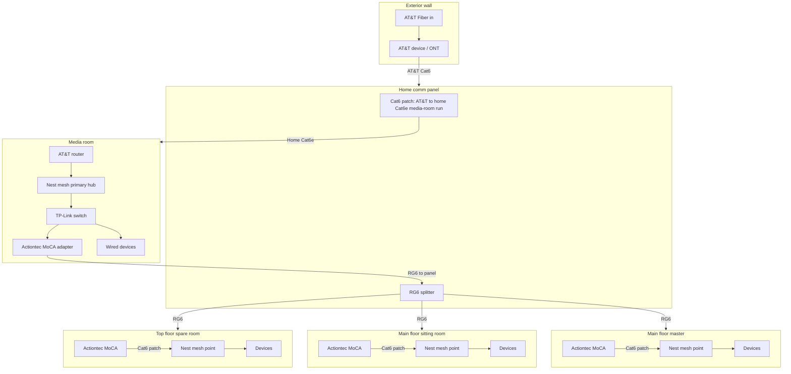
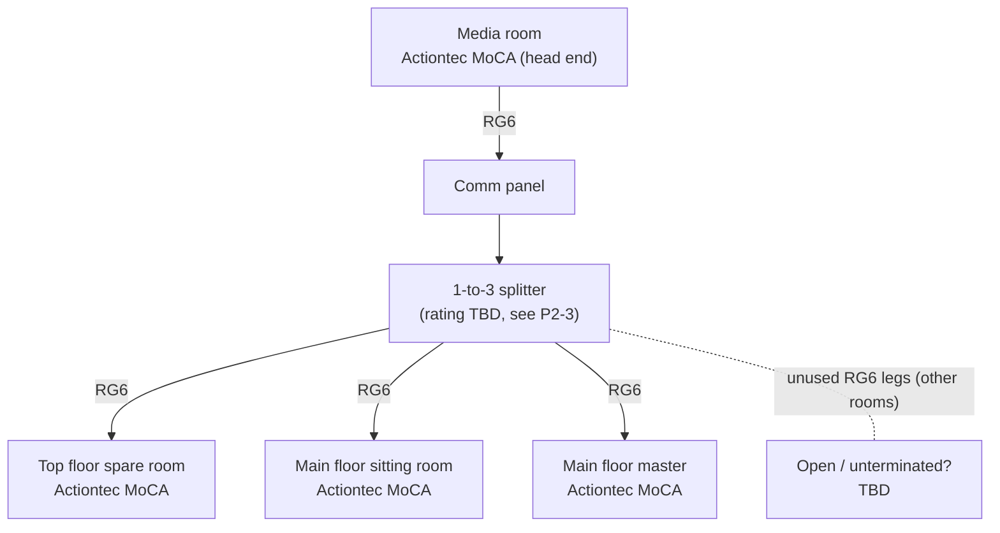

# Phase 1: As Found

Documented October 2026. This describes the network exactly as it was found, with no changes applied.

## 1. Building infrastructure (passive)

| Medium | Where | Termination at room | Termination at panel | Notes |
|---|---|---|---|---|
| Cat6e | Every room | Cut down to a **POTS (RJ11-style) plug/jack** | Home comm panel | Usually **not** located near RG6 or the media cabinet |
| RG6 coax | Every room, on 1 or more walls | Wall plate (F-connector) | Home comm panel | Multiple outlets per room in some rooms |

Key observation: the Cat6e is physically capable of gigabit Ethernet, but a POTS-style termination typically uses only 2 to 4 of the 8 conductors, so the room-end jacks cannot carry Ethernet until re-terminated (see Phase 2, item P2-1).

## 2. Active network, logical order

1. **WAN**: AT&T Fiber
2. **Exterior wall penetration**: AT&T device (ONT). Fiber in, AT&T Cat6 out.
3. **Home comm panel**: AT&T Cat6 is **patched to the home Cat6e run that goes to the media room**.
4. **Media room**:
   - AT&T router (gateway)
   - AT&T router to **Nest mesh primary hub**
   - Nest mesh to **TP-Link switch**, which feeds wired devices
   - TP-Link switch to **Actiontec MoCA adapter**
   - Actiontec MoCA to **RG6**, which runs back to the comm panel
5. **Home comm panel (coax side)**: RG6 from the media room goes into a **splitter**, which feeds RG6 to:
   - Top-floor spare room
   - Main-floor sitting room
   - Main-floor master
6. **Each of those three rooms**: an Actiontec MoCA adapter converts coax back to Ethernet (Cat6 patch), which connects to a **Nest mesh point** in that room, plus any local wired devices.

## 3. Schematic A: Physical topology



## 4. Schematic B: Logical (L2/L3) view

```mermaid
flowchart LR
    INET((Internet)) --- ATT[AT&T router<br/>gateway, NAT, DHCP?]
    ATT --- HUB[Nest primary hub<br/>router mode?]
    HUB --- SW[TP-Link switch]
    SW --- WIRED[Wired media-room devices]
    SW --- MC0[MoCA 0]
    MC0 ~~~|"coax: shared MoCA channel"| MC1[MoCA 1: spare room]
    MC0 ~~~ MC2[MoCA 2: sitting room]
    MC0 ~~~ MC3[MoCA 3: master]
    MC1 --- P1[Nest point]
    MC2 --- P2[Nest point]
    MC3 --- P3[Nest point]
    HUB -. "Wi-Fi mesh (wireless backhaul or wired via MoCA)" .- P1
    HUB -. . - P2
    HUB -. . - P3
```

Items marked with `?` are **not yet verified**. Capture them using the checks in [04-verification.md](04-verification.md):

- Whether the AT&T gateway is the DHCP server and whether the Nest hub is behind it as a second router (double NAT).
- Whether each Nest point uses the wired MoCA path as backhaul or falls back to wireless.

## 5. Schematic C: Coax (MoCA) plant



All other RG6 runs in the house terminate at the panel but are **not used** by the active network as found. Whether unused legs are capped (75-ohm terminators) is `TBD`.

## 6. Port and cable map (fill in per run)

| Run ID | Room | Medium | Room-end termination | Panel port | Used as found? | Device at room end |
|---|---|---|---|---|---|---|
| C-01 | Media room | Cat6e | POTS | TBD | Yes (carries AT&T uplink to media room) | AT&T router WAN side |
| C-02..n | Other rooms | Cat6e | POTS | TBD | **No** | None |
| R-01 | Media room | RG6 | F | TBD | Yes (MoCA head end) | Actiontec MoCA |
| R-02 | Top floor spare | RG6 | F | splitter | Yes | Actiontec MoCA |
| R-03 | Main floor sitting | RG6 | F | splitter | Yes | Actiontec MoCA |
| R-04 | Main floor master | RG6 | F | splitter | Yes | Actiontec MoCA |
| R-05..n | Other walls/rooms | RG6 | F | TBD | **No** | None |

## 7. Replication notes (as found)

To reproduce this topology in another house:

1. Bring AT&T Fiber to the ONT on an exterior wall; run Cat6 from the ONT to the comm panel.
2. At the panel, patch that Cat6 onto the structured Cat6 run that serves the room hosting the router (here the media room).
3. In that room: gateway, then mesh primary, then switch; one switch port to an Actiontec MoCA adapter, whose coax output goes to a wall F-connector.
4. At the panel, join that RG6 leg to a splitter and send one splitter output to each remote room's RG6 leg.
5. In each remote room: Actiontec MoCA adapter from wall coax; Ethernet to a mesh point and any wired devices.
6. Power each MoCA adapter, confirm they form one MoCA network (all on the same channel), then add the mesh points.

## 8. Known limitations of the as-found design

Summarized here, detailed in Phase 2:

- Home-run Cat6e is installed to every room but **not used for data**.
- All remote rooms share **one MoCA channel and one splitter** (shared bandwidth, extra loss).
- Router/hub stacking may cause **double NAT** and Wi-Fi roaming quirks.
- Media room is the network core, but the comm panel is the natural core.
