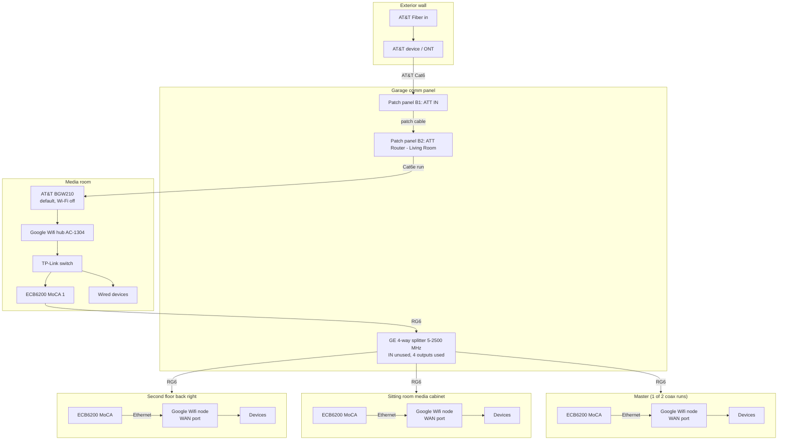
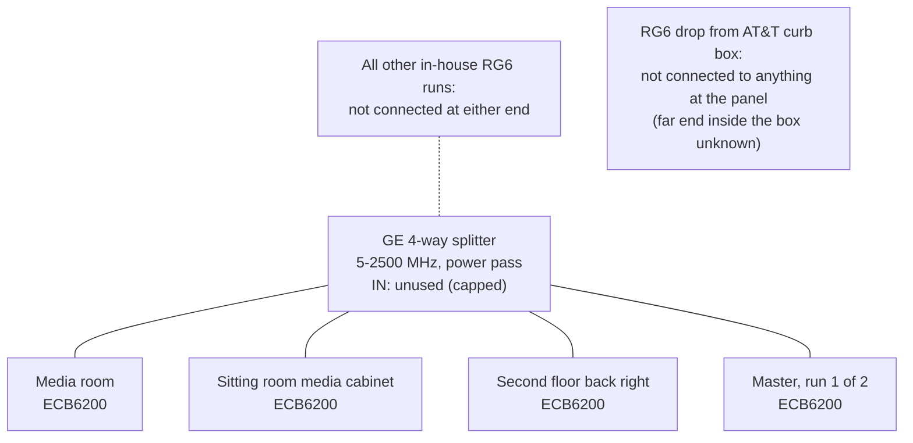
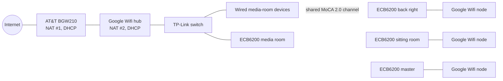

# Phase 1: As Found

Documented October 2026, updated after a configuration interview. This describes the network exactly as it was found, with no changes applied, except where noted that the owner had already re-terminated the Cat6e (see section 1).

## 1. Building infrastructure (passive)

| Medium | Where | Termination | Notes |
|---|---|---|---|
| Cat6e | Every room, home-run to the garage comm panel | **Panel end:** RJ45 keystone jacks on a keystone patch panel (all runs; converted by the owner before this survey). **Room end:** RJ45 in **only two rooms** so far; the rest are still **POTS-style plugs** | Which two rooms are RJ45 is open question O-2. POTS room ends use only 2 to 4 of 8 conductors, so those rooms cannot carry gigabit Ethernet yet. Rooms are usually not near RG6 or the media cabinet |
| RG6 coax | Every room, on 1 or more walls, home-run to the comm panel | F-connector wall plates; compression F-connectors at the panel | **Only 4 in-house runs are connected** (see section 5). All other in-house RG6 runs are not connected at either end. A separate **RG6 copper drop runs from an AT&T box at the curb to the panel**. It is **not connected to anything** at the panel; what it connects to inside the curb box is unknown |

### Cat6e patch panel map

12 keystone ports in two banks of 6. Source: the owner's "Ethernet Bank in Garage" sheet, also stored as [data/patch-panel.csv](data/patch-panel.csv).

| Port | Label | Used as found? |
|---|---|---|
| A1 | Great Room | Not confirmed |
| A2 | Master | Not confirmed |
| A3 | UNK | Unidentified |
| A4 | Upstairs Center | Not confirmed |
| A5 | UNK | Unidentified |
| A6 | UNK | Unidentified |
| B1 | **ATT IN** | **Yes**: AT&T Cat6 from the exterior ONT |
| B2 | **ATT Router - Living Room** | **Yes**: patched from B1; run to the router |
| B3 | UNK | Unidentified |
| B4 | UNK | Unidentified |
| B5 | Kitchen | Not confirmed |
| B6 | Attic Cable | Not confirmed |

5 of 12 ports are unidentified. Phase 2 starts by identifying them (P2-0).

## 2. Equipment (confirmed)

| Role | Make / model | Qty | Detail |
|---|---|---|---|
| Fiber terminal | AT&T external device (ONT) | 1 | On exterior wall; AT&T Cat6 to the panel |
| Gateway | AT&T **BGW210** | 1 | **Default settings** (no IP Passthrough), **Wi-Fi off**. Gigabit-class LAN ports |
| Mesh | Google Wifi, model **AC-1304**, software 14150.376.32 | 4 (hub + 3 nodes) | Owner calls it "Nest". All units are **identical**, each with 2 gigabit Ethernet ports (WAN + LAN). Mesh nodes **backhaul over MoCA (wired)** |
| Switch | TP-Link (model TBD) | 1 | Media room |
| MoCA adapter | Actiontec **ECB6200** (MoCA 2.0, gigabit Ethernet port) | 4 | Media room + 3 remote rooms. Assumed identical |
| Coax splitter | GE digital **4-way**, **5 to 2500 MHz**, power pass all ports | 1 | At panel. **IN port unused**; all four outputs in use (see section 5) |

## 3. Logical order

1. WAN: AT&T Fiber to the exterior ONT, AT&T Cat6 to patch panel port **B1**.
2. Patch B1 to **B2**, a Cat6e run to the **AT&T BGW210** in the media room (sheet says "Living Room"; see O-1).
3. Media room: BGW210, then Google Wifi hub, then TP-Link switch (feeds wired devices), then an Actiontec ECB6200 whose coax goes to the splitter at the panel.
4. Remote rooms: coax from the splitter to an ECB6200, then Ethernet into the WAN port of a Google Wifi unit (the mesh node), plus any local wired devices on its LAN port.
5. Result: the BGW210 (NAT) feeds the Google Wifi hub (second NAT). Double NAT is present.

## 4. Schematic A: Physical topology

## 5. Schematic B: Coax (MoCA) plant

The splitter is used with its **IN port unused**. The media room is one of four peer legs, not the head end. MoCA works this way because every node reaches every other node through the splitter.

The street drop is deliberately shown disconnected from the splitter. Keeping it that way means MoCA signals cannot leak out to the street, and nothing from outside enters the in-house coax.

Splitter fact check: 5 to 2500 MHz fully covers the MoCA 2.0 band (about 1125 to 1675 MHz), so the rating is adequate. A 4-way splitter has about 6 to 8 dB loss per leg, which is acceptable for MoCA. Note one gold right-angle adapter on one leg (identity TBD).

## 6. Schematic C: Logical (L2/L3) view

Wired backhaul is carried over the shared MoCA channel. Wi-Fi from each node serves devices in that area.

## 7. Replication notes (as found)

1. Bring AT&T Fiber to the ONT on an exterior wall; run Cat6 from the ONT to the comm panel and land it on patch panel port B1.
2. Patch B1 to the Cat6e run serving the router room (B2).
3. In the router room: BGW210, then Google Wifi hub, then switch; one switch port to an ECB6200 whose coax goes to a wall F-connector.
4. At the panel, connect the four RG6 legs (router room, plus the three remote rooms) to the four **output** ports of a 5-2500 MHz 4-way splitter; leave the IN port unused.
5. In each remote room: ECB6200 from wall coax; Ethernet to the WAN port of a Google Wifi unit; local wired devices on its LAN port.
6. Confirm all four ECB6200s join one MoCA network, then add the Google Wifi nodes.

## 8. Known limitations of the as-found design

- **Double NAT**: BGW210 in default mode in front of the Google Wifi hub.
- **Shared MoCA 2.0 channel** for all remote rooms, with real-world throughput typically a few hundred Mbps shared (well under gigabit).
- **Cat6e reaches the panel on a patch panel but no switch is there**, so the Cat6e is not carrying room traffic yet (apart from the AT&T uplink).
- **Room ends are mostly still POTS**: only two rooms have been converted to RJ45, so most rooms cannot use the Cat6e for Ethernet even once a switch is added.
- **5 of 12 patch ports unidentified.**
- **Mesh hardware**: Google Wifi AC-1304 is the 2016 generation (AC1200-class Wi-Fi).

## Open questions

- **O-1**: The sheet says "Living Room"; the narrative says "media room". Are they the same room, and is "Great Room" a third space?
- **O-2**: Which two rooms have RJ45 at the room end, and which port does each land on?
- **O-3**: Are all four ECB6200s the same model and firmware?
- **O-4**: Measured speeds (AT&T plan tier; media room vs each remote room, wired and Wi-Fi).
- **O-5**: Which rooms map to the unidentified ports A3, A5, A6, B3, B4?
- **O-6**: What is the gold right-angle adapter on the splitter, and which leg is it on?
- **O-7**: The RG6 drop terminates at an AT&T box at the curb and its far end inside is not visible. Treat it as possibly live. Only AT&T can say what it is connected to. Is there a ground block where it enters the house?
